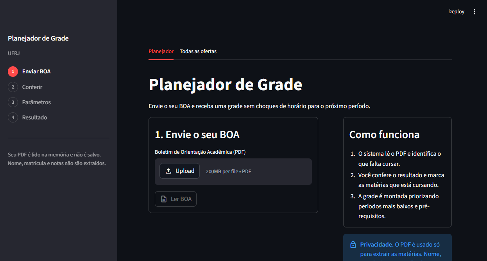
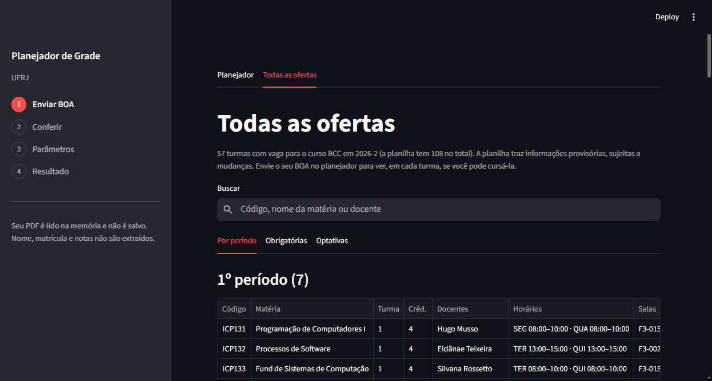

# AutoGrade

Planejador automático de grade horária para o curso de Ciência da Computação da UFRJ.

O AutoGrade lê o Boletim de Orientação Acadêmica (BOA), identifica a situação das disciplinas no currículo e gera versões de grade sem choques de horário. A solução considera os pré-requisitos, o limite de créditos, a oferta de turmas e a preferência por áreas de interesse.

## Teste o produto

Você pode testar a aplicação diretamente no navegador:

**https://auto-grade-sandbox.streamlit.app/**

## Visão geral

O aplicativo funciona em quatro etapas:

1. **Envie o BOA** em formato PDF.
2. **Conferir** as disciplinas cumpridas e pendentes.
3. **Parâmetros**: configure créditos, matérias em curso, optativas e prioridade da grade.
4. **Resultado**: consulte até três versões de grade, confira a disponibilidade das turmas e realize ajustes manuais.

Também é possível consultar todas as ofertas cadastradas, pesquisando por código, nome da matéria ou docente.

### Tela inicial



### Consulta das ofertas



## Principais recursos

- Extração das informações acadêmicas diretamente do PDF do BOA.
- Identificação de disciplinas cumpridas, pendentes e vedadas.
- Cálculo das disciplinas liberadas ao considerar matérias como já cumpridas.
- Geração exata de combinações de turmas sem choque de horários.
- Respeito ao limite de créditos e às regras de optativas.
- Até três alternativas de grade com diferenças relevantes entre si.
- Priorização configurável por:
  - períodos mais baixos;
  - equilíbrio entre período e pré-requisitos;
  - maior quantidade de pré-requisitos destravados.
- Preferência por área de interesse para optativas condicionadas.
- Edição manual da grade após a geração automática.
- Visualização da grade em tabela por dia da semana e horário.
- Exportação dos horários em CSV.
- Consulta separada de todas as ofertas por período, obrigatórias e optativas.

## Privacidade

O PDF é processado em memória e não é armazenado no servidor. O sistema não mantém o nome, matrícula ou notas do usuário e conserva apenas as matérias cumpridas e pendentes necessárias para montar as opções de grade nesta sessão.

## Como executar localmente

### Pré-requisitos

- Python 3.10 ou superior
- `pip`

### Instalação

```bash
git clone https://github.com/DaviMattos14/AutoGrade.git
cd AutoGrade
python -m pip install -r requirements.txt
```

### Iniciar a aplicação

```bash
streamlit run app.py
```

A interface estará disponível em `http://localhost:8501`.

## Estrutura do projeto

- `app.py`: interface web em Streamlit e fluxo das etapas.
- `extrator_boa.py`: leitura e interpretação do PDF do BOA.
- `motor_grade.py`: regras curriculares, cálculo de pré-requisitos e busca das melhores combinações.
- `grades_curricular/`: dados JSON dos currículos.
- `ofertas/`: dados JSON das ofertas por período.
- `relatorios/`: materiais auxiliares e relatórios do projeto.
- `test_motor_grade.py`: testes automatizados do motor de grades.

## Tecnologias

- Python
- Streamlit
- pdfplumber
- Matplotlib

## Testes

Execute os testes do motor com:

```bash
python -m unittest test_motor_grade.py
```

## Observação

As informações das ofertas são baseadas em planilhas fornecidas pela universidade e podem ser provisórias ou sofrer alterações. Antes da matrícula, confirme os horários e a situação das turmas nos canais oficiais da UFRJ.
